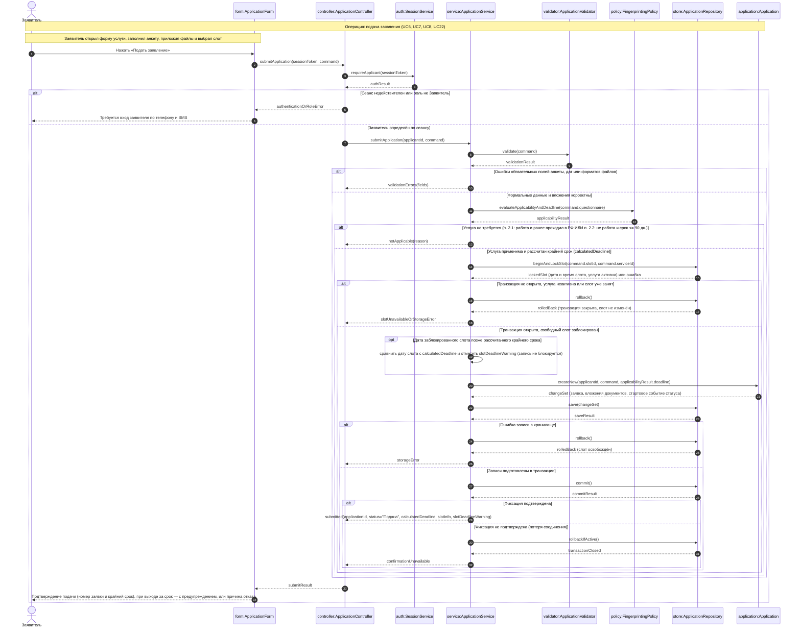

# Лабораторная работа № 4. Диаграмма последовательностей на уровне классов (прецедент «Подать заявление», UC22)

## Выбранный прецедент

**«Подать заявление» (`UC22`)** (включающий обязательные шаги заполнения анкеты `UC6`, приложения документов `UC7` и выбора слота записи `UC8`) из [первой лабораторной работы](use_case.md). Диаграмма раскрывает внутреннее взаимодействие объектов приложения на уровне «белого ящика», детализируя соответствующий этап подачи обращения из [системной диаграммы последовательностей](system_sequence.md) по услуге «Дактилоскопия и фотографирование» (пункты 2.1–2.2 дорожной карты).

Предварительная регистрация и авторизация по номеру телефона и SMS-коду (`UC1`–`UC3`), настройка справочников администратором (`UC17`–`UC19`), последующая проверка заявления сотрудником (`UC13`), физическое снятие отпечатков в отделении МВД/ПВС и завершение заявки (`UC16`) относятся к другим прецедентам и в данном сценарии не выполняются.

## Объекты и распределение ответственности

Обозначение `имя-Класс` фиксирует конкретный экземпляр класса, участвующий в выполнении операции. `Заявитель` — внешний актор; остальные линии жизни — программные объекты приложения. Сплошные стрелки (`->>`) обозначают синхронные вызовы методов, пунктирные (`-->>`) — возврат результатов или структур ошибок, блоки `alt / else` — взаимоисключающие ветви выполнения.

| Объект | Ответственность |
| --- | --- |
| `form-ApplicationForm` | Собирает данные анкеты, загруженные копии документов и идентификатор выбранного слота, инициирует запрос в контроллер и отображает подтверждение подачи либо текст ошибки. Не содержит бизнес-правил и не обращается к БД напрямую. |
| `controller-ApplicationController` | Принимает команду от формы, проверяет права через сервис сеансов, передаёт идентификатор заявителя из проверенного сеанса в прикладной сервис и формирует итоговый ответ для интерфейса. |
| `auth-SessionService` | Проверяет действительность `sessionToken` и наличие у пользователя роли `Заявитель`. Идентификатор `applicantId` извлекается исключительно из сеанса, а не принимается на доверии из клиентской формы. |
| `service-ApplicationService` | Координирует весь сценарий подачи обращения- запускает формальную валидацию, вызывает политику предметных правил, управляет транзакцией БД, блокировкой слота и сохранением нового обращения. |
| `validator-ApplicationValidator` | Проверяет заполнение обязательных полей анкеты (цель въезда, дата въезда в РФ, планируемый срок пребывания, отметки о прошлой дактилоскопии и патенте), логическую корректность дат, а также наличие, допустимые форматы и размеры приложенных файлов. |
| `policy-FingerprintingPolicy` | Применяет предметные правила пунктов 2.1 и 2.2 дорожной карты- определяет применимость процедуры и вычисляет нормативный крайний срок (`calculatedDeadline`). |
| `store-ApplicationRepository` | Инкапсулирует работу с хранилищем данных- открывает транзакцию, блокирует выбранный слот (`SLOT`) от конкурентного бронирования, проверяет активность услуги (`SERVICE`) и атомарно сохраняет подготовленный набор изменений. |
| `application-Application` | Доменный объект создаваемой заявки. Инициализирует начальный статус `«Подана»`, связывает реквизиты анкеты, вложения и слот, а также формирует первую запись журнала переходов статусов. |

Разделение на форму, контроллер, сервисы, политику правил и репозиторий представляет собой проектное распределение ответственности; выбор конкретного языка программирования, веб-фреймворка и СУБД относится к этапу реализации (`lab06`). Служебные классы (`ApplicationForm`, `ApplicationValidator`, `FingerprintingPolicy`, `ApplicationRepository`) не добавляют новых бизнес-сущностей в [ER-модель](er.md).

## Данные и порядок вызовов

Объект `command` передаётся из формы в контроллер и содержит реквизиты анкеты (`entryGoal`, `entryDate`, `plannedStayDays`, `hasPreviousFingerprinting`, `appliesForPatent`, `patentApplyDate`), список приложенных файлов (`files` с указанием `documentKind`), а также идентификаторы `serviceId` и `slotId`.

1. **Аутентификация и проверка роли-** контроллер вызывает `requireApplicant(sessionToken)` у `auth-SessionService`. Если сеанс истёк или роль не соответствует `Заявителю`, обработка сразу прерывается с возвратом `authenticationOrRoleError`.
2. **Формальная валидация команды-** `validator-ApplicationValidator` проверяет заполнение обязательных реквизитов, наличие обязательных документов (паспорт, миграционная карта), допустимые расширения/размеры вложений и обязательность указания `patentApplyDate` при установленном признаке `appliesForPatent = true`.
3. **Проверка применимости (п. 2.1–2.2) и расчёт крайнего срока-** `policy-FingerprintingPolicy` оценивает параметры визита
   * **п. 2.1 (цель `«работа»`)-** если `hasPreviousFingerprinting = true` (процедура уже проводилась на территории РФ), возвращается `notApplicable` и создание заявки блокируется; если `false` — услуга применима, а `calculatedDeadline` вычисляется по формуле `min(entryDate + 30 календарных дней, patentApplyDate)` (если обращение за патентом происходит раньше 30-дневного срока);
   * **п. 2.2 (цель `«не работа»`)-** при `plannedStayDays > 90` услуга применима без блокировки по факту прошлой дактилоскопии (в соответствии с дорожной картой), а `calculatedDeadline = entryDate + 90 календарных дней`; при `plannedStayDays <= 90` возвращается `notApplicable`.
4. **Блокировка слота, сверка срока и подготовка набора изменений-** `store-ApplicationRepository` открывает транзакцию и блокирует строку выбранного `SLOT` (`beginAndLockSlot`) для защиты от двойного бронирования, возвращая дату и время слота. Сервис сравнивает дату слота с рассчитанным крайним сроком (`calculatedDeadline`): если дата слота позже срока, в итоговый результат включается признак `slotDeadlineWarning`, и форма показывает заявителю предупреждение, не блокируя подачу. Доменный класс `Application` методом `createNew` формирует согласованный `changeSet`, включающий новую заявку, привязанные вложения документов и стартовое событие истории.
5. **Сохранение и фиксация транзакции-** репозиторий записывает `changeSet` методом `save` и выполняет `commit()`. Только после подтверждённой фиксации сервис возвращает контроллеру результат `submitted` с идентификатором заявки, статусом `«Подана»`, рассчитанным дедлайном, признаком выхода даты слота за срок (если есть) и реквизитами записи.

## Целостность данных и обработка альтернатив

* **Атомарность бронирования и создания заявки-** операция `save(changeSet)` внутри одной транзакции сохраняет запись `APPLICATION` в статусе `«Подана»`, связанные записи `DOCUMENT`, обновляет состояние слота (`SLOT.is_available = false`) и добавляет начальное событие `STATUS_EVENT` (статус `«Подана»`, инициатор — заявитель). Частичное сохранение (например, занятый слот без созданной заявки или заявка без документов) исключено.
* **Защита от конкурентной записи и откат транзакции-** метод `beginAndLockSlot` удерживает блокировку на выбранном слоте до завершения транзакции. Если два заявителя одновременно попытаются занять один и тот же слот, второй запрос получит `slotUnavailableOrStorageError` и предложение выбрать другое время; перед возвратом ошибки репозиторий сам откатывает открытую транзакцию (`rollback()`), оставляя слот без изменений. Механизм согласуется с признаком занятости `SLOT.is_available` и связью `SLOT`–`APPLICATION` в [ER-модели](er.md).
* **Откат при сбоях и неопределённый исход фиксации-**
  * при любой ошибке до открытия транзакции (недействительный сеанс, ошибки валидации, неприменимость по п. 2.1–2.2) состояние базы данных не изменяется;
  * при ошибке записи после блокировки слота (`storageError`) сервис сначала выполняет `rollback()`, освобождая слот (`rolledBack`), и затем возвращает ошибку в контроллер;
  * при потере связи после вызова `commit()`, когда подтверждение не получено (`confirmationUnavailable`), `rollbackIfActive()` безопасно закрывает незавершённую транзакцию на стороне приложения, а форма предлагает заявителю обновить список заявок в личном кабинете (`UC12`), чтобы проверить фактический статус заявки.

## Основания

Формат лабораторной работы № 4 (`class_sequence.md`, ровно один блок `sequenceDiagram` с нотацией `имя-Класс`, фокусировка на одной операции — подаче заявления — из `lab01` и текстовое обоснование) соответствует требованиям курса ПИС. Предметные правила применимости, расчёта дедлайнов и статусов полностью согласованы с пунктами 2.1–2.2 дорожной карты, диаграммой прецедентов, ER-моделью и системной диаграммой последовательностей.
