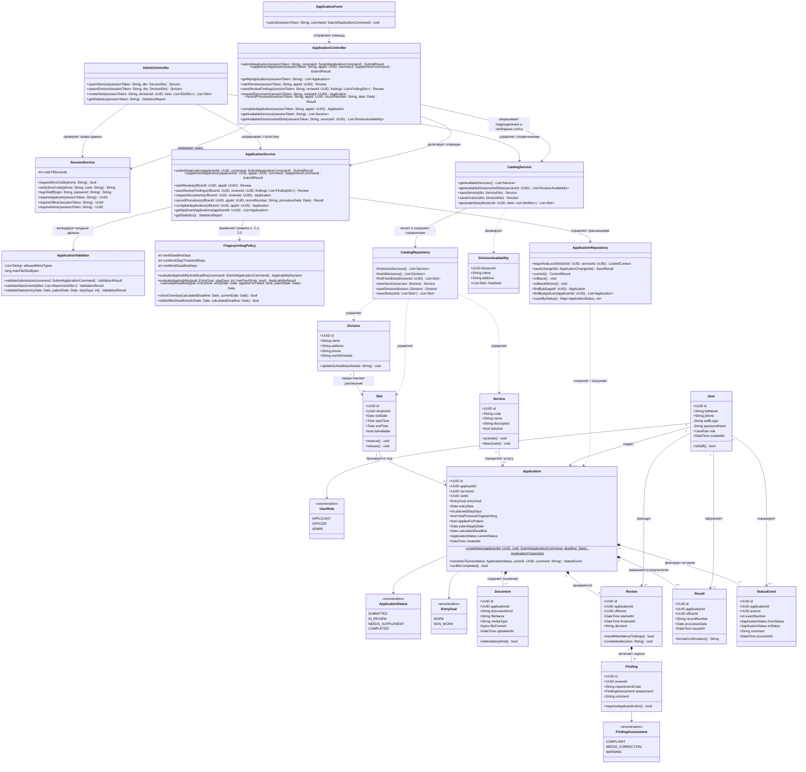

# Лабораторная работа № 5. Диаграмма классов приложения

Диаграмма классов (`classDiagram`) проектирует объектно-ориентированную структуру приложения для оказания государственной услуги **«Дактилоскопия и фотографирование»** (раздел 2, пункты 2.1–2.2 дорожной карты). Модель объединяет сущности предметной области из [ER-модели](er.md), роли и прецеденты из [диаграммы прецедентов](use_case.md), а также сервисные объекты, задействованные в [диаграмме последовательностей классов](class_sequence.md).

Система разделена на три архитектурных слоя для соблюдения принципа единственной ответственности

1. **Слой управления и аутентификации (Controllers & Auth)**
   * `SessionService` — обеспечивает регистрацию и вход заявителей по номеру телефона и одноразовому SMS-коду (`requestSmsCode`, `verifySmsCode`), служебную авторизацию сотрудников и администраторов (`loginStaff`), а также проверку токенов и ролей (`requireApplicant`, `requireOfficer`, `requireAdmin`).
   * `ApplicationController` — точка входа для пользовательских сценариев заявителя и сотрудника МВД/ПВС: приём первичного заявления (`submitApplication`), отправка доработок (`supplementApplication`), просмотр истории (`getMyApplications`), проведение проверки (`startReview`, `saveReviewFindings`, `requestDocuments`), фиксация очного прохождения процедуры (`recordProcedure`) и отдельное завершение заявки (`completeApplication`).
   * `AdminController` — точка входа для административных сценариев (`UC17`–`UC20`): управление услугами (`upsertService`), подразделениями МВД/ПВС (`upsertDivision`), расписанием слотов (`createSlots`) и просмотр статистики (`getStatistics`).

2. **Слой прикладной логики и предметных правил (Services & Domain Policies)**
   * `ApplicationValidator` — выполняет формальную проверку входных команд, обязательных реквизитов анкеты, логической согласованности дат и допустимых форматов/размеров приложенных сканов документов.
   * `FingerprintingPolicy` — инкапсулирует бизнес-правила пунктов 2.1 и 2.2 дорожной карты: определяет применимость процедуры (`evaluateApplicability`), рассчитывает нормативный крайний срок (`calculateDeadline`) — **30 календарных дней со дня въезда для цели «работа» (при этом дата обращения за патентом заменяет 30-дневный срок только в том случае, если обращение за патентом происходит раньше)** либо **90 календарных дней со дня въезда для иных целей пребывания свыше 90 суток**, а также проверяет соблюдение срока по дате выбранного слота и фактической дате прохождения процедуры (`checkOverdue`).
   * `ApplicationService` — координирует жизненный цикл обращения: управляет транзакциями при подаче заявки, запускает цикл проверки и возврата на доработку, контролирует наличие подтверждённого результата перед переводом заявки в статус «Завершена».
   * `CatalogService` — отвечает за выборку свободных слотов по подразделениям и ведение справочников услуг и расписания. Для UC4 контроллер проверяет сеанс заявителя и вызывает `CatalogService.getAvailableServices()`, который читает активные услуги через `CatalogRepository.findActiveServices()`. Для выбора места `CatalogService` проверяет, что выбрана активная услуга дактилоскопии и фотографирования, читает справочник подразделений, получает свободные слоты каждого и возвращает `DivisionAvailability` с названием, адресом и временем приёма.

3. **Слой доступа к данным и доменная модель (Repositories & Domain Entities)**
   * `ApplicationRepository` и `CatalogRepository` — изолируют логику работы с БД, включая транзакционную блокировку выбранного слота (`beginAndLockSlot`) и атомарное сохранение набора изменений (`save`, `commit`, `rollback`).
   * Доменные классы (`User`, `Service`, `Division`, `Slot`, `Application`, `Document`, `Review`, `Finding`, `Result`, `StatusEvent`) и перечисления (`UserRole`, `ApplicationStatus`, `EntryGoal`, `FindingAssessment`) отражают структуру сущностей из [ER-модели](er.md) и дополняют её поведением (методы смены статуса `transitionTo`, резервирования слота `reserve`, проверки готовности к завершению `canBeCompleted`).

## Реализация ключевых бизнес-правил в методах классов

* **История заявителя.** `ApplicationController.getMyApplications` получает `applicantId` через `SessionService.requireApplicant` и вызывает `ApplicationService.getApplicantApplications`. Сервис загружает только заявки этого владельца и их историю через `ApplicationRepository.findByApplicant`. Подтверждение доступно по завершённой заявке.
* **Отметка визита и завершение (UC15 и UC16).** Для обеих операций контроллер вызывает `requireOfficer`. При UC15 сервис сохраняет `Result` с номером записи, фактической датой и сотрудником, фиксирует предупреждение о просрочке при необходимости и сохраняет текущий статус. При UC16 сервис проверяет статус «На проверке», сохранённый результат и соответствие обязательных требований. Одной транзакцией он устанавливает дату выдачи результата, переводит заявку в «Завершена» и сохраняет событие истории. Информационное предупреждение о просрочке допускает завершение по решению сотрудника.
* **Доработка.** Сотрудник запрашивает исправления через `requestDocuments`, когда в проверке есть хотя бы одно требование с оценкой «Требует исправления». При повторной отправке документов заявителем сервис проверяет владельца и статус «Требует дополнения». По исправленной анкете, в том числе при изменении даты или цели въезда, сервис повторно проверяет применимость услуги и пересчитывает крайний срок. Если услуга неприменима, сервис объясняет причину и сохраняет прежние данные и статус. Если услуга применима, сервис сохраняет исправления и новый срок, возвращает заявку в «На проверке» и добавляет событие истории.

* **Применимость и расчёт срока (`FingerprintingPolicy`)**
  * метод `evaluateApplicability` блокирует создание заявки при цели `WORK` (п. 2.1), если `hasPrevPrints == true`, и при цели `NON_WORK` (п. 2.2), если `stayDays <= 90`;
  * метод `calculateDeadline` для цели `WORK` возвращает дату обращения за патентом (`patentDate`), если обращение есть и оно наступает раньше базового срока, в остальных случаях — `entryDate + 30 календарных дней` со дня въезда; для цели `NON_WORK` (> 90 дней) — `entryDate + 90 календарных дней`;
  * метод `checkOverdue` сравнивает дату с `calculatedDeadline` в двух местах жизненного цикла: при выборе слота — дату слота (`slotDate`, предупреждение заявителю при выходе за срок, запись не блокируется), при фиксации результата — фактическую дату процедуры (`procedureDate`); при просрочке фиксируется замечание с оценкой `WARNING`, которое не блокирует завершение заявки.
* **Транзакционная целостность бронирования (`Slot` и `ApplicationRepository`)**
  * при подаче заявки `ApplicationRepository.beginAndLockSlot` блокирует строку `Slot`, метод `Slot.reserve()` переводит `isAvailable` в `false`, а статический фабричный метод `Application.createNew(...)` формирует согласованный набор (`Application`, `Document`, стартовый `StatusEvent`).
* **Контроль завершённости (`Application` и `Result`):**
  * метод `Application.canBeCompleted()` проверяет наличие связанного объекта `Result` (с номером записи `recordNumber` и датой `procedureDate`) перед вызовом `transitionTo(COMPLETED, ...)`, гарантируя, что заявка не может быть завершена без отметки о фактическом прохождении дактилоскопии и фотографирования в отделении МВД/ПВС.

## Типы связей и согласованность с ER-моделью

* **Композиция (`*--`):** дочерние сущности жизненного цикла обращения (`Document`, `Review`, `Result`, `StatusEvent`) не существуют отдельно от `Application`, а оценки (`Finding`) принадлежат конкретной проверке `Review`. Открытая проверка создаётся методом `startReview` без единой оценки (кратность `0..*`): оценки сохраняются вызовом `saveReviewFindings`, а обязательность полного набора оценок по обязательным проверяемым требованиям подтверждается при вынесении решения методом `Review.hasAllMandatoryFindings()`. При удалении родительской заявки связанные записи удаляются каскадно.
* **Ассоциация (`-->`):** отражает ссылки между независимыми сущностями справочников и участниками (`User` подаёт `Application`, `Division` предоставляет `Slot`, `Slot` связывается с одной `Application` с кратностью `1` к `0..1`).
* **Зависимость (`..>`):** репозитории создают и материализуют доменные объекты при чтении и записи в хранилище данных.
* **Подразделения и слоты.** В учебной модели все подразделения справочника оказывают услугу дактилоскопии и фотографирования. Для активной услуги `CatalogService` читает их через `CatalogRepository.findAllDivisions()`. Администратор создаёт слоты через `generateSlots`. `generateSlots` проверяет, что начало раньше окончания. `CatalogRepository.saveSlots` сохраняет весь набор одной транзакцией и отклоняет пересечения внутри набора и с существующими слотами того же подразделения, в том числе при параллельном сохранении. См. [ER-модель](er.md#связи-и-кратности).
* **Документы и учётные записи.** `Document.fileContent` и `mediaType` сохраняются в БД. При подаче валидатор применяет [правило обязательных вложений](use_case.md#заявитель). Заявитель входит по телефону и SMS-коду, а сотрудник и администратор — по уникальному `staffLogin` и паролю. При служебном входе `SessionService` проверяет пароль по `passwordHash`.

## Основания

Формат документа (`classes.md`, ровно один блок `classDiagram` с указанием атрибутов, методов, типов связей и текстовым обоснованием) соответствует требованиям лабораторной работы № 5 курса ПИС. Состав классов, ролей, статусов и предметных правил полностью согласован с пунктами 2.1–2.2 дорожной карты, [диаграммой прецедентов](use_case.md), [ER-моделью](er.md), [системной диаграммой последовательностей](system_sequence.md) и [диаграммой последовательностей классов](class_sequence.md). Составная операция `evaluateApplicabilityAndDeadline(...)`, показанная на [диаграмме последовательностей классов](class_sequence.md), на уровне архитектуры классов детализирована в виде двух отдельных методов класса `FingerprintingPolicy`: `evaluateApplicability(...)` и `calculateDeadline(...)`.
