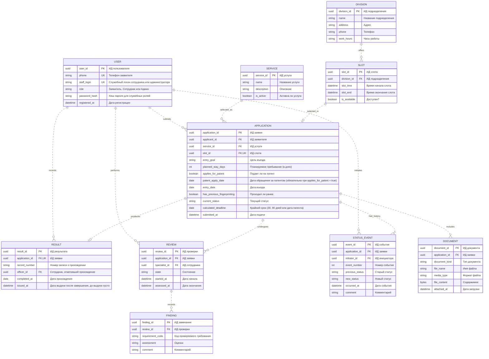

# Лабораторная работа № 2. ER-диаграмма предметной области

# Границы модели

Модель описывает сервис прохождения дактилоскопии и фотографирования по пунктам 2.1–2.2 задания: проверка сроков, запись в подразделение МВД/ПВС, приложение документов и фиксация результата. Роли, операции и состояния согласованы с диаграммой прецедентов. Снятие отпечатков пальцев и фотографирование происходят офлайн в отделении и находятся вне сервиса. Результат услуги — это подтверждение факта прохождения процедуры в приложении, а не выдача официального документа.

Показаны сущности предметной области, их атрибуты и связи. PK — первичный ключ, FK — внешний ключ, UK — уникальное значение. Типы логические, конкретная СУБД пока не выбрана. Английские идентификаторы используются в диаграмме, русские названия и смысл приведены ниже.

## Сущности и атрибуты

| Сущность | Назначение |
|---|---|
| USER — пользователь | Учётная запись с одной из трёх ролей. Для заявителя обязателен уникальный телефон. Для заранее созданных служебных аккаунтов обязательны уникальный логин и хеш пароля. |
| APPLICATION — заявка | Обращение заявителя. Хранит цель въезда, планируемое пребывание, признак подачи на патент, дату обращения за патентом, дату въезда и признак прошлой дактилоскопии. Эти поля нужны для точного расчета дедлайна. |
| DOCUMENT — документ | Документы и их содержимое в БД. Обязательны сканы паспорта и миграционной карты, скан визы можно приложить при наличии. См. [правило UC7](use_case.md#заявитель). |
| REVIEW — проверка | Работа сотрудника с заявкой. Сотрудник проверяет данные анкеты и документы по каждому требованию. |
| FINDING — замечание | Результат проверки конкретного требования по его идентификатору `requirement_code` (например, проверка паспорта, миграционной карты или срока). |
| RESULT — результат | Подтверждение факта прохождения процедуры: номер записи и дата. |
| DIVISION — подразделение | Справочник отделений МВД/ПВС: адрес, телефон, часы работы. |
| SERVICE — услуга | Справочник государственных услуг (включая "Дактилоскопия и фотографирование"), которым управляет администратор. |
| SLOT — слот записи | Доступное время для записи. Привязано к конкретному подразделению. |
| STATUS_EVENT — событие истории | Переход состояния заявки с датой, инициатором и комментарием. |

## Связи и кратности

`||` означает ровно один объект, `o|` — ноль или один, `o{` — ноль или много, `|{` — один или много.

| Связь | Ограничение и обоснование |
|---|---|
| USER — APPLICATION | Один заявитель может подать много заявок. Но каждая заявка принадлежит только одному человеку. Сотрудник не может быть владельцем заявки. |
| APPLICATION — DOCUMENT | У каждой поданной заявки есть хотя бы один файл. Но каждый файл лежит только в одной заявке. |
| APPLICATION — REVIEW | Заявку могут проверять несколько раз. Но каждая проверка относится только к одной заявке. |
| REVIEW — FINDING | В рамках одной проверки сотрудник может написать много замечаний. Но каждое замечание относится только к одной проверке. |
| APPLICATION — RESULT | У заявки может быть только один результат (или ноль, пока она не завершена). Система не даст выдать две справки по одной заявке. |
| DIVISION — SLOT | В одном подразделении МВД или ПВС может быть много слотов. Но каждый слот относится только к одному отделению. |
| SERVICE — APPLICATION | Одна услуга из справочника может быть выбрана во многих заявках. Но каждая заявка оформляется на одну конкретную услугу. |
| SLOT — APPLICATION | Каждая заявка ссылается на один слот. Уникальность `APPLICATION.slot_id` не позволяет двум заявкам занять один слот. Ограничение `UNIQUE (division_id, slot_time)` в `SLOT` запрещает повторное создание слота с тем же временем начала в одном подразделении. В учебной модели один слот рассчитан на одного заявителя. |
| APPLICATION / USER — STATUS_EVENT | У каждой заявки есть история. Каждое изменение фиксируется с указанием, какой именно пользователь нажал кнопку. |

## Предметные правила и целостность данных

**Применимость.** По учебному заданию сервис принимает анкету иностранного гражданина. Приложение проверяет поля `entry_goal` (цель въезда), `planned_stay_days` (планируемое пребывание) и `has_previous_fingerprinting` (проходил ли ранее):
* **Пункт 2.1 (трудовые мигранты):** если цель — работа (`entry_goal` = "работа"), система проверяет флаг `has_previous_fingerprinting`. Если он равен `false` (ранее процедура на территории РФ не проводилась) — применяется п. 2.1 и создаётся заявка. Если `has_previous_fingerprinting` равен `true` — повторное прохождение не требуется, система информирует об этом и блокирует создание заявки.
* **Пункт 2.2 (длительное пребывание):** если цель — не работа и планируется пребывание >90 суток (`planned_stay_days` > 90), применяется п. 2.2. В соответствии с дорожной картой блокировка по полю `has_previous_fingerprinting` для этой категории не применяется — заявка формируется.
* **Неприменимость:** если цель — не работа и планируемое пребывание ≤90 суток, услуга не требуется и заявка не создаётся.

**Справочники.** Заявитель не может создать заявку без выбранной услуги (`service_id`) и слота (`slot_id`). Справочник услуг заполняется админом в `SERVICE`, подразделения — в `DIVISION`, а слоты — в `SLOT` с привязкой к `DIVISION`. В учебной модели услугу дактилоскопии и фотографирования оказывают все подразделения справочника. Подать заявление можно только для включённой в каталог активной услуги дактилоскопии и фотографирования и доступного слота.

**Расчёт дедлайна.** Система рассчитывает `calculated_deadline` на основе цели въезда, даты въезда (`entry_date`), признака обращения за патентом (`applies_for_patent`) и даты обращения за патентом (`patent_apply_date`). Если заявитель обращается за патентом (`applies_for_patent` = `true`), поле `patent_apply_date` **обязательно**: без даты обращения невозможно определить, наступает ли срок обращения раньше 30-дневного периода:
* **Для трудовых мигрантов (п. 2.1):** базовый дедлайн равен `entry_date` + 30 календарных дней. Если заявитель обращается за патентом (`applies_for_patent` = `true`) и дата обращения за патентом наступает раньше 30-дневного срока (`patent_apply_date` < `entry_date` + 30 дней), дедлайн приравнивается к `patent_apply_date` (процедура проходится при обращении за патентом, если оно происходит раньше).
* **Для длительного пребывания (п. 2.2):** дедлайн равен `entry_date` + 90 календарных дней.

**Проверка сроков.** Крайний срок (`calculated_deadline`) относится к дате прохождения самой процедуры, а не к дате проверки заявления: заявку можно проверить вовремя, а визит пройти позже дедлайна. Поэтому срок проверяется в двух местах:
* **при планировании визита:** при выборе слота система сравнивает дату и время слота (`SLOT.slot_time`) с `calculated_deadline`; если слот позже крайнего срока — заявителю показывается предупреждение, но запись не блокируется;
* **после визита:** при фиксации результата система сравнивает фактическую дату прохождения (`RESULT.completed_at`) с `calculated_deadline`; если процедура пройдена позже срока, создаётся замечание `DEADLINE_CHECK` с оценкой "Предупреждение" (текст "Срок просрочен"). Замечание о просрочке носит **предупреждающий (информационный) характер** и не блокирует заявку: правила дорожной карты устанавливают нормативный срок, но не требуют автоматического отказа или возврата документов при его нарушении. Итоговое решение о завершении заявки при просрочке принимает сотрудник.

**Офлайн-процедура.** Сама процедура снятия отпечатков и фотографирования происходит вне системы. После очного визита заявителя сотрудник фиксирует факт прохождения в `RESULT` (номер записи, фактическая дата): система сравнивает `RESULT.completed_at` с `calculated_deadline` и при просрочке создаёт замечание `DEADLINE_CHECK` (оценка "Предупреждение", не блокирующее). Наличие сохранённой записи `RESULT` является обязательным предусловием для следующего действия — завершения заявки: сотрудник подтверждает завершение и переводит её в статус "Завершена", устанавливает `RESULT.issued_at` и фиксирует переход в `STATUS_EVENT` в одной транзакции, в том числе при наличии предупреждения о просрочке.

**Проверка.** Для заявки допускается не более одной открытой проверки. Каждая запись `FINDING` привязывается к конкретному проверяемому требованию через уникальный в рамках одной `REVIEW` идентификатор `requirement_code` (например, `DOC_PASSPORT`, `DOC_MIGRATION_CARD`, `FORM_DATA`, `DEADLINE_CHECK`), что исключает дублирующую оценку одного пункта и позволяет точно определить полноту проверки. Сохранение промежуточных оценок допускает состояние "Оценка сохранена" без запроса документов и без завершения. Для перевода заявки в статус "Требует дополнения" нужен хотя бы один пункт `FINDING` с оценкой "Требует исправления". Для завершения заявки все обязательные проверяемые требования (`requirement_code`) по документам и данным должны иметь оценку "Соответствует", при этом наличие предупреждающего замечания о просрочке срока (`DEADLINE_CHECK` с оценкой "Предупреждение") не препятствует завершению по решению сотрудника.

**Единственный результат.** Для одной заявки допускается не более одного `RESULT`. Запрос документов ("Требует дополнения") и завершение заявки ("Завершена") являются взаимоисключающими исходами проверки.

**Состояния и история.** Первая подача создаёт статус "Подана"; начало проверки — "На проверке"; запрос документов — "Требует дополнения"; повторная отправка после исправления — "На проверке"; завершение — "Завершена". Текущий статус в `APPLICATION` всегда совпадает с `new_status` последнего события в `STATUS_EVENT`. Инициатор подачи и дополнения — заявитель, инициатор начала проверки и принятия решений — сотрудник.

**Архив и доступ.** Ранее оказанные услуги — завершённые заявки пользователя. Заявитель читает только свои данные; сотрудник получает доступ к проверке заявок; админ управляет только справочниками подразделений, слотов и услуг.

Регистрация и вход по телефону из `use_case.md` используют сущность `USER`. Одноразовые SMS-коды и сеансы являются техническими данными авторизации и не входят в предметную ER-модель.

## Пример прохождения заявки

Заявитель заполняет анкету: указывает цель "Работа", дату въезда и планируемое пребывание. Прикладывает паспорт и миграционную карту (при наличии может добавить визу), выбирает слот в подразделении и отправляет. Создаются заявка, записи документов, бронь и событие "Подана". Рассчитывается дедлайн (например, дата въезда + 30 дней или дата подачи на патент).

Сотрудник открывает заявку, начинает проверку и переводит её в статус "На проверке". Затем он проверяет каждое требование по его `requirement_code` (документы, данные анкеты) и сохраняет оценки "Соответствует" в `FINDING`. Заявитель приходит в отделение и проходит процедуру офлайн. При фиксации результата в `RESULT` (номер записи и дата) система сравнивает фактическую дату прохождения с дедлайном; при просрочке создаётся пометка `DEADLINE_CHECK` ("Предупреждение"), не блокирующая завершение. После сохранения результата сотрудник отдельным действием завершает заявку и переводит её в статус "Завершена". История фиксирует каждое изменение в `STATUS_EVENT`.

Заявитель видит подтверждение прохождения и полную историю заявки.

## Основания

Формат lab02 — er.md, один блок erDiagram и пояснения — установлен README преподавателя и labs.json. Предметные условия взяты из раздела 2 задания; процесс проверки, офлайн-фиксация результата и справочники — решения учебного проекта, согласованные с lab01.
