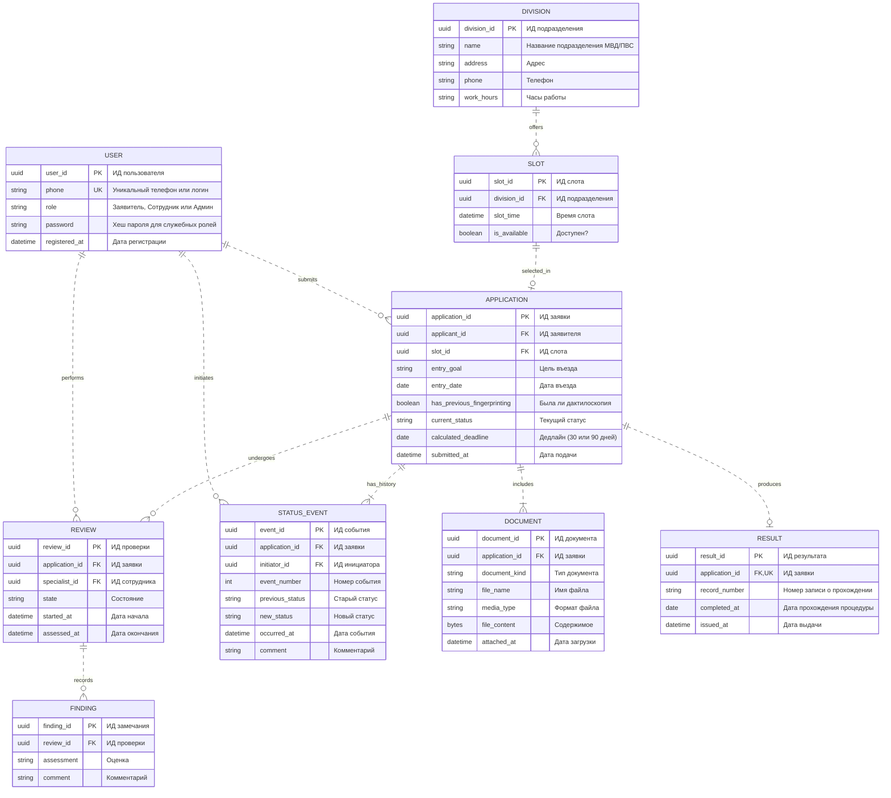

# Лабораторная работа № 2. ER-диаграмма предметной области

# Границы модели
Модель описывает сервис прохождения дактилоскопии и фотографирования по пунктам 2.1–2.2 задания: проверка сроков, запись в подразделение МВД/ПВС, приложение документов и фиксация результата. Роли, операции и состояния согласованы с диаграммой прецедентов. Снятие отпечатков пальцев и фотографирование происходят офлайн в отделении и находятся вне сервиса. Результат услуги — это подтверждение факта прохождения процедуры в приложении, а не выдача официального документа.

Показаны сущности предметной области, их атрибуты и связи. PK — первичный ключ, FK — внешний, UK — уникальное значение. Типы логические, конкретная СУБД пока не выбрана. Английские идентификаторы используются в диаграмме, русские названия и смысл приведены ниже. Это проектная модель команды, а не дополнительные требования преподавателя.

# Сущности и атрибуты
| Сущность | Назначение |
|---|---|
| `USER` — пользователь | Учётная запись с уникальным телефоном (или логином) и одной из трёх ролей: «Заявитель», «Сотрудник», «Админ». Роль ограничивает операции. Сотрудник и Админ создаются заранее; публичная регистрация создаёт заявителя. |
| `APPLICATION` — заявка | Обращение одного заявителя, дата первоначальной подачи и текущее состояние. Хранит цель въезда и дату въезда для расчёта дедлайна. Один заявитель может подать несколько независимых заявок. |
| `DOCUMENT` — приложенный документ | Один файл, подтверждающий личность или статус (паспорт, миграционная карта, виза). Несколько файлов могут относиться к одной заявке. Содержимое и метаданные сохраняются в БД. |
| `REVIEW` — проверка версии | Работа одного сотрудника с одной заявкой. Сотрудник проверяет данные и сроки, сохраняет оценку. Новая проверка создаётся при повторной подаче после исправлений. |
| `FINDING` — оценка пункта | Результат проверки конкретного требования. Уникальна пара `(review_id, finding_id)`. Комментарий объясняет недостаток (например, «просрочен срок») либо подтверждает соответствие. |
| `RESULT` — результат | Подтверждение факта прохождения процедуры: номер записи и дата. Создаётся только после завершения проверки. |
| `DIVISION` — подразделение | Справочник отделений МВД/ПВС: адрес, телефон, часы работы. Заполняется администратором. |
| `SLOT` — слот записи | Доступное время для записи на процедуру. Привязано к конкретному подразделению. Админ настраивает, заявитель выбирает. |
| `STATUS_EVENT` — событие истории | Переход состояния заявки с датой, инициатором и комментарием. Порядок задаёт номер события внутри заявки, даже если даты совпали. История сохраняется после завершения услуги. |

# Связи и кратности
|| означает ровно один объект, o| — ноль или один, o{ — ноль или много, |{ — один или много. В модели используются самостоятельные идентификаторы сущностей, поэтому связи показаны неидентифицирующими пунктирными линиями в смысле ER-нотации Mermaid: ключ родителя не входит в первичный ключ потомка.

| Связь | Ограничение и обоснование |
| :--- | :--- |
| `USER` — `APPLICATION` | Один заявитель может подать **много** заявок (например, если первую отклонили, он подает вторую). Но каждая заявка принадлежит **только одному** человеку. Сотрудник не может быть владельцем заявки, он только проверяет её. |
| `APPLICATION` — `DOCUMENT` | К одной заявке можно прикрепить **много** файлов (паспорт, виза, миграционная карта). Но каждый конкретный файл лежит **только в одной** заявке. Если заявитель загрузит один и тот же паспорт в две разные заявки, в базе это будут две разные записи. |
| `APPLICATION` — `REVIEW` | Заявку могут проверять **несколько раз** (например, сначала сотрудник нашел ошибку, заявитель исправил, потом проверяет другой сотрудник). Но каждая проверка относится **только к одной** заявке. |
| `REVIEW` — `FINDING` | В рамках одной проверки сотрудник может написать **много** замечаний (нет паспорта, просрочен срок, плохое фото). Но каждое замечание относится **только к одной** проверке. |
| `APPLICATION` — `RESULT` | У заявки может быть **только один** результат (или ноль, пока она не завершена). Система не даст выдать две справки по одной и той же заявке. |
| `DIVISION` — `SLOT` | В одном отделении МВД может быть **много** свободных слотов (на разные даты и время). Но каждый слот относится **только к одному** конкретному отделению. |
| `SLOT` — `APPLICATION` | На одно конкретное время (например, 10 ноября в 10:00) может записаться **только один** человек. Когда слот занят, он привязывается к заявке, и другие люди это время уже не увидят. |
| `APPLICATION` / `USER` — `STATUS_EVENT` | У каждой заявки есть **история** (сначала «Подана», потом «На проверке» и т.д.). Каждое такое изменение фиксируется с указанием, **какой именно пользователь** нажал кнопку (заявитель отправил или сотрудник проверил). |

# Предметные правила и целостность данных
**Применимость.** По учебному заданию сервис принимает анкету иностранного гражданина. Если цель въезда — работа, применяется п. 2.1 (срок 30 дней или до подачи на патент). Если не работа и планируется пребывание >90 суток — п. 2.2 (срок 90 дней). Если условие не выполнено (например, срок ≤90 суток при нетрудовой цели), система объясняет неприменимость и не создаёт заявку.

**Расчёт дедлайна.** Система рассчитывает calculated_deadline на основе цели въезда и даты въезда. Для работы: дата въезда + 30 дней (или дата подачи на патент, если раньше). Для длительного пребывания: дата въезда + 90 дней. Это значение сохраняется в заявке.

**Проверка сроков.** Сотрудник при проверке сравнивает текущую дату с calculated_deadline. Если срок просрочен — создаётся FINDING с текстом «Срок просрочен», заявка не принимается, сотрудник запрашивает исправления или отказывает.

**Офлайн-процедура.** Сама процедура снятия отпечатков и фотографирования происходит вне системы. Сотрудник фиксирует её результат в RESULT (номер записи, дата) и меняет статус заявки на «Завершена».

**Справочники.** Заявитель не может создать заявку без выбранного slot_id. Слоты создаются админом в SLOT и привязываются к DIVISION. Если слотов нет — запись невозможна. Это условие работы приложения, а не отдельный прецедент.

**Проверка.** Для заявки допускается не более одной открытой проверки. Сохранение полной оценки допускает состояние «Оценка сохранена» без запроса и завершения; заявка остаётся «На проверке». Для запроса нужен хотя бы один пункт «Требует исправления». Для завершения все требования должны иметь оценку «Соответствует». Завершённые проверки не перезаписываются.

**Единственный результат.** Для одной заявки допускается не более одного RESULT во всех её проверках. Запрос документов и завершение заявки взаимоисключающие исходы проверки. После запроса её состояние — «Требует дополнения», после завершения — «Завершена». Это ограничения бизнес-процесса сверх изображённых кратностей.

**Состояния и история.** Первая подача создаёт «Подана»; начало проверки — «На проверке»; запрос — «Требует дополнения»; принятый ответ — снова «Подана»; завершение — «Завершена». Другие переходы не допускаются. Текущий статус совпадает с последним событием, а previous_status — с предыдущим событием; у первого он пуст. Изменение статуса, запись события и сохранение связанного решения выполняются атомарно. Инициатор подачи — владелец, начала проверки и решений — сотрудник.

**Архив и доступ.** Ранее оказанные услуги — завершённые заявки пользователя с их документами, результатом и историей. Отдельная сущность архива не требуется. Заявитель читает только свои данные; сотрудник получает доступ для проверки комплекта; админ управляет только справочниками. Удаление учётной записи или файла не должно разрушать историю оказанной услуги.

Регистрация и вход по телефону из lab01 используют USER. Одноразовые SMS-коды и сеансы — технические данные авторизации, а не сущности предметной ER-модели; их хранение определяется при реализации. Реальные SMS и внешние государственные API не нужны.

# Пример прохождения заявки
Заявитель заполняет анкету (указывает цель «Работа» и дату въезда), прикладывает скан паспорта, выбирает слот в подразделении и отправляет. Создаются заявка, документ, событие «Подана». Рассчитывается дедлайн (например, дата въезда + 30 дней).

Сотрудник начинает проверку, сохраняет оценки требований (срок соблюдён) и переводит заявку в «На проверке». Заявитель приходит в отделение и проходит процедуру офлайн. Сотрудник фиксирует результат в RESULT (номер записи и дата), меняет статус на «Завершена». История фиксирует изменения в STATUS_EVENT.

Заявитель видит подтверждение прохождения и полную историю заявки.

# Основания
Формат lab02 — er.md, один блок erDiagram и пояснения — установлен README преподавателя и labs.json, повторно прочитанными 18.10.2026. Предметные условия взяты из раздела 2 задания; процесс проверки, офлайн-фиксация результата и справочники — решения учебного проекта, согласованные с lab01. Выбор СУБД и диаграммы последующих лабораторных в эту работу не входят.
