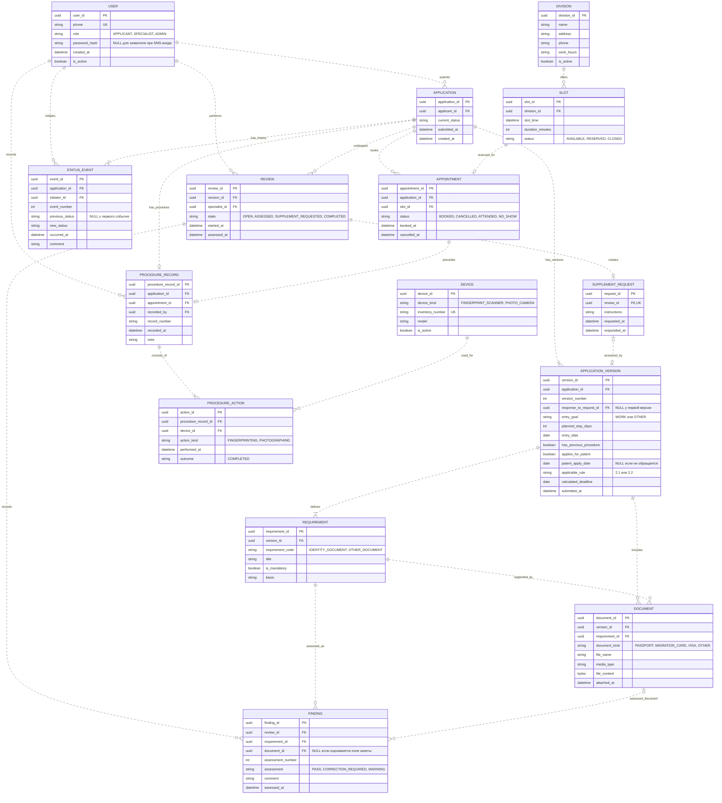

# Лабораторная работа № 2. ER-диаграмма предметной области

## Границы модели

Модель описывает сервис сопровождения дактилоскопической регистрации и фотографирования по пунктам 2.1–2.2 дорожной карты  анкета, применимая ветка, крайний срок, заявление, удостоверение личности и другие приложения, запись, проверки, замечания, история статусов и подтверждение обеих процедур.

Процедуры выполняются офлайн. Система хранит факт выполнения, дату, подразделение, номер записи и использованное оборудование, но не сами отпечатки, биометрические шаблоны или изображение лица.

## Диаграмма

## Сущности

| Сущность | Назначение |
|---|---|
| `USER` | Учётная запись заявителя, сотрудника или администратора. |
| `APPLICATION` | Заявка и её текущий статус. |
| `APPLICATION_VERSION` | Неизменяемый снимок данных при первой подаче или дополнении, хранит входные данные для выбора ветки и расчёта срока. |
| `REQUIREMENT` | Проверяемое требование конкретной версии. Обязательное удостоверение личности выделено отдельным требованием. |
| `DOCUMENT` | Файл, приложенный к версии и подтверждающий конкретное требование. |
| `REVIEW` | Цикл проверки одной версии одним сотрудником. |
| `FINDING` | Отдельная оценка требования или документа. Повторные оценки одного требования хранятся отдельными строками. |
| `SUPPLEMENT_REQUEST` | Решение сотрудника запросить исправления, исправленная версия ссылается на этот запрос. |
| `APPOINTMENT` | Запись заявки на слот, отдельная сущность сохраняет отмены и повторные записи. |
| `DIVISION`, `SLOT` | Справочники подразделений и доступных интервалов. |
| `DEVICE` | Справочник оборудования. |
| `PROCEDURE_RECORD` | Сводная запись о фактическом прохождении процедур  номер записи, дата и сотрудник. |
| `PROCEDURE_ACTION` | Отдельное действие — дактилоскопия или фотографирование. Каждое действие ссылается на конкретный прибор. |
| `STATUS_EVENT` | Неизменяемое событие истории статусов. |

## Связи и кратности

- Один заявитель может создать 0..N заявок, каждая заявка принадлежит ровно одному заявителю.
- У заявки 1..N принятых версий, номер версии уникален внутри заявки и возрастает последовательно.
- У версии 1..N требований, требование `IDENTITY_DOCUMENT` обязательно для каждой принятой версии.
- У версии и требования может быть 0..N документов. Каждый документ относится к одной версии и одному её требованию.
- У версии 0..N проверок, каждая проверка относится к одной версии и одному сотруднику.
- У проверки 0..N оценок, каждая оценка относится к одному требованию этой версии и, если оценивается файл, к одному документу.
- Проверка создаёт не более одного запроса дополнения, запрос может иметь 0..1 ответную версию, а исправленная версия ссылается не более чем на один запрос.
- У заявки 0..N записей на приём, один слот может иметь не более одной активной записи.
- У подразделения 0..N слотов, каждый слот принадлежит одному подразделению.
- У заявки 0..1 итоговая запись процедуры, в ней должны присутствовать два действия  `FINGERPRINTING` и `PHOTOGRAPHING`.
- Каждое действие процедуры использует ровно одно устройство. Одно устройство может использоваться во многих действиях.
- У заявки 1..N событий истории, уникальна пара `(application_id, event_number)`.

## Предметные правила и целостность данных

### 1. Применимость

- **Пункт 2.1 ** `entry_goal = WORK`. Если `has_previous_procedure = true`, повторная процедура по этой ветке не требуется и заявка не создаётся. Если `false`, заявка может быть подана.
- **Пункт 2.2 ** `entry_goal = OTHER` и `planned_stay_days > 90`. Признак `has_previous_procedure` не блокирует эту ветку  дорожная карта устанавливает ограничение предыдущего прохождения только для п. 2.1.
- Иная цель и пребывание не более 90 дней  услуга по п. 2.2 не применяется.

`applicable_rule` хранит `2.1` или `2.2` для принятой версии. Нельзя определять применимость только по признаку предыдущего прохождения.

### 2. Расчёт крайнего срока

- Для п. 2.1 базовая дата — `entry_date + 30 календарных дней`. Если заявитель обращается за патентом и `patent_apply_date` наступает раньше базовой даты, крайний срок равен `patent_apply_date`, иначе используется базовая дата.
- Для п. 2.2 крайний срок — `entry_date + 90 календарных дней`.
- `calculated_deadline` — итоговая крайняя дата с учётом более раннего обращения за патентом, а не просто подпись «30 или 90 дней».
- Если текущая дата позже срока, создаётся предупреждение. Дорожная карта не устанавливает автоматическую блокировку или отказ из-за просрочки, решение принимает сотрудник.

### 3. Проверка документов и повторные оценки

- Для каждой принятой версии создаётся обязательное требование `IDENTITY_DOCUMENT`.
- `FINDING` ссылается на `REQUIREMENT`, а при оценке конкретного файла — также на `DOCUMENT`. Поэтому каждое замечание относится к определённому требованию и документу.
- Уникальность `(review_id, requirement_id)` намеренно не устанавливается. Повторные оценки одного требования сохраняются отдельными строками с возрастающим `assessment_number` и временем, предыдущие оценки не перезаписываются.
- `WARNING` не равен `CORRECTION_REQUIRED`  предупреждение о сроке не считается недостатком документа и само по себе не препятствует завершению.
- Для запроса дополнения нужна оценка `CORRECTION_REQUIRED`. Для завершения у каждого обязательного требования должна быть последняя актуальная оценка `PASS`, предупреждения допускаются.

### 4. Запись и слоты

- Слот резервируется, только если он активен, открыт и свободен.
- Проверка доступности и резервирование выполняются атомарно, чтобы исключить двойную запись.
- Отмена записи сохраняется в истории. Заявка не может быть связана с закрытым или занятым слотом.

### 5. Очная процедура и оборудование

- Дактилоскопия и фотографирование — два самостоятельных действия. Наличие только одного не позволяет завершить заявку.
- Для каждого `PROCEDURE_ACTION` обязателен `device_id`  для дактилоскопии — `FINGERPRINT_SCANNER`, для фотографирования — `PHOTO_CAMERA`.
- Система хранит тип действия, время, исход и прибор, но не хранит отпечатки, биометрические шаблоны или изображение лица.
- `PROCEDURE_RECORD` создаётся сотрудником после фактического прохождения обеих процедур. Повторная запись не должна создавать второй итоговый результат по заявке.

### 6. Состояния и история

Основной цикл  `Подана` → `На проверке` → `Требует дополнения` → `Подана` (новая версия) → `На проверке` → `Завершена`.

- Статус `На проверке` устанавливается в момент начала проверки, **до сохранения оценок**.
- Сохранение оценок не переносит начало проверки на более поздний момент.
- `Требует дополнения` устанавливается при решении сотрудника запросить исправления.
- Отправка исправленной версии возвращает заявку в `Подана`.
- Отметка прохождения процедуры сама по себе не меняет статус на `Завершена`.
- `Завершена` устанавливается отдельным действием сотрудника, только если обязательные требования имеют актуальные оценки `PASS` и сохранены обе записи `PROCEDURE_ACTION`.
- `APPLICATION.current_status` совпадает с `new_status` последнего `STATUS_EVENT`. Изменение статуса, событие истории и связанное решение сохраняются одной транзакцией.

### 7. Версионность, доступ и хранение

- Принятая версия анкеты и её документы неизменяемы. Исправление создаёт следующую версию, связанную с запросом дополнения.
- У первой версии `response_to_request_id` пуст, у исправленной версии он указывает на запрос, по которому она создана.
- Заявитель работает только со своими заявками, сотрудник проверяет заявки и фиксирует процедуру, администратор управляет подразделениями и слотами.
- Файлы хранятся в БД либо в файловом хранилище с устойчивой ссылкой и метаданными в БД.

## Пример прохождения заявки

Заявитель указывает цель «Работа», дату въезда, отсутствие предыдущей процедуры в РФ и сведения об обращении за патентом. Система выбирает п. 2.1 и рассчитывает срок как более раннюю дату между въездом + 30 дней и датой обращения за патентом, если она раньше. Заявитель прикладывает удостоверение личности, выбирает слот и отправляет заявление. Создаются заявка, версия, требования, документы, запись и первое событие «Подана».

Сотрудник начинает проверку. **В этот момент** создаётся `REVIEW`, статус меняется на «На проверке» и добавляется `STATUS_EVENT`. Только после этого сотрудник сохраняет оценки. Если документ не подходит, создаётся `FINDING` с `CORRECTION_REQUIRED`, сотрудник запрашивает дополнение, заявитель отправляет новую версию.

После успешной проверки заявитель проходит процедуры очно. Сотрудник сохраняет два `PROCEDURE_ACTION`, каждый со своим `device_id`. Когда обязательные требования имеют актуальные оценки `PASS` и обе процедуры отмечены, сотрудник завершает заявку.

## Примечание о границах источника

Дорожная карта прямо задаёт условия применимости и сроки 2.1–2.2, но не содержит исчерпывающего списка загружаемых файлов, обязательной онлайн-записи и учёта оборудования. Удостоверение личности включено по замечанию проверки, слоты и справочник устройств — проектные решения, а не дословные требования дорожной карты.
