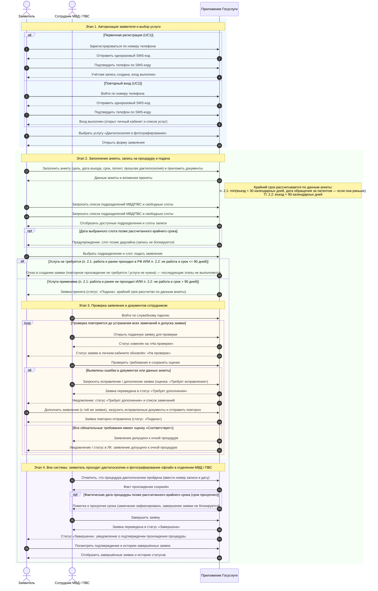

# Лабораторная работа № 3. Системная диаграмма последовательностей. Прецедент "Подать заявление"

## Диаграмма

## Границы моделирования и принцип «чёрного ящика»

Диаграмма последовательностей (`sequenceDiagram`) моделирует сквозной процесс оказания государственной услуги **«Дактилоскопия и фотографирование»** (раздел 2, пункты 2.1–2.2 дорожной карты) от авторизации заявителя до завершения обращения и просмотра результата. Прецеденты заявителя и сотрудника (UC1–UC16, UC22) покрываются этапами 1–4; служебные действия администратора по настройке справочников (UC17–UC19) выполняются заранее и указаны в предусловиях. Использование диаграммы внутри ветви применимости (см. `alt / else` на Этапе 2) гарантирует, что проверка, доработка и завершение возможны только для принятой заявки.

Приложение представлено как единый **«чёрный ящик»** (`Приложение Госуслуги`) без раскрытия внутренних классов, контроллеров, сервисов и прямых обращений к таблицам БД (внутренняя архитектура детализируется в следующей лабораторной работе):

* **Внешние участники (акторы):** `Администратор`, `Заявитель` и `Сотрудник МВД / ПВС`.
* **Обозначения сообщений:** сплошные стрелки (`->>`) отражают обращения и передачу данных от пользователей в систему; пунктирные стрелки (`-->>`) — ответы, подтверждения и уведомления, возвращаемые на экран.
* **Фрагменты управления потоком:**
  * `alt / else` — взаимоисключающие ветви сценария (выбор первичной регистрации или входа; проверка применимости услуги по п. 2.1–2.2, где этапы 3–4 проверки и завершения вложены только в ветвь принятой заявки);
  * `opt` — необязательное действие, выполняемое только при наступлении условия (предупреждение о слоте позже крайнего срока при записи на процедуру, фиксация пометки о просрочке при отметке факта прохождения);
  * `loop` — цикл повторной проверки заявки сотрудником после устранения замечаний и повторной отправки документов заявителем.
* **Вне границ системы:** физическое снятие отпечатков пальцев и фотографирование выполняются офлайн при личном визите заявителя в выбранное подразделение МВД или ПВС.

## Границы моделирования и принцип «чёрного ящика»

**Выбранный основной прецедент из первой лабораторной работы-** **«Подать заявление» (`UC22`)** по государственной услуге «Дактилоскопия и фотографирование» (раздел 2, пункты 2.1–2.2 дорожной карты). Диаграмма раскрывает полный жизненный цикл обращения — от входа заявителя и подачи заявления до проверки документов сотрудником МВД/ПВС, фиксации очного прохождения процедуры и получения подтверждения результата.

* **Принцип «чёрного ящика»** на диаграмме показаны только внешние действующие лица (**Заявитель** и **Сотрудник МВД/ПВС**) и само **Приложение Госуслуги** как единая система. Внутренние контроллеры, сервисы, классы и таблицы базы данных здесь намеренно не раскрываются (они детализируются в `class_sequence.md` и `classes.md`).
* **Предусловия и внесистемные действия**
  * **Администратор** заранее заполнил справочники услуг, подразделений МВД/ПВС и расписание слотов записи (поэтому его настройка не повторяется при подаче каждого заявления); просмотр администратором сводной статистики относится к отдельному сценарию.
  * Физическое снятие отпечатков пальцев и фотографирование происходят **офлайн** в отделении МВД или ПВС (отражено примечанием перед фиксацией результата на Этапе 4).

## Описание этапов и правила дорожной карты (п. 2.1–2.2)

1. **Этап 1. Авторизация заявителя и выбор услуги:** заявитель регистрируется или входит в систему по номеру телефона и одноразовому SMS-коду, выбирает услугу «Дактилоскопия и фотографирование» и открывает форму заявления.
2. **Этап 2. Заполнение анкеты, выбор слота и подача заявления:**
   * заявитель заполняет сведения о визите (цель въезда, дата въезда в РФ, планируемый срок пребывания, признак прошлой дактилоскопии в РФ, признак и дата обращения за патентом) и прикладывает копии обязательных документов;
   * система рассчитывает нормативный крайний срок прохождения процедуры:
     * **п. 2.1 (цель «работа»):** базовый срок составляет 30 календарных дней со дня въезда, но если заявитель обращается за патентом и дата обращения наступает раньше 30-дневного срока, крайний срок приравнивается к дате обращения за патентом — `min(въезд + 30 календарных дней, дата обращения за патентом)`;
     * **п. 2.2 (цель «не работа» при пребывании > 90 дней):** крайний срок составляет `въезд + 90 календарных дней`;
   * заявитель выбирает подразделение и слот записи; если дата выбранного слота превышает рассчитанный крайний срок, система выводит предупреждение о нарушении нормативного срока, но не блокирует запись;
   * при нажатии «Подать заявление» система проверяет применимость: при цели «работа» и наличии прошлой дактилоскопии в РФ (п. 2.1) либо при цели «не работа» и сроке пребывания 90 дней и менее (п. 2.2) создание заявки отклоняется, и последующие этапы не выполняются; в остальных случаях заявка создаётся в статусе «Подана».
3. **Этап 3. Проверка заявления и документов сотрудником:** сотрудник МВД/ПВС входит по служебному паролю и открывает заявку (статус «На проверке»). В цикле `loop` проверяются требования к анкете и сканам: при выявлении недочётов заявка переводится в статус «Требует дополнения», а заявитель исправляет сведения и/или досылает документы к той же заявке и отправляет её повторно («Подана»). После подтверждения всех требований заявление допускается к очной процедуре.
4. **Этап 4. Офлайн-процедура, завершение заявки и просмотр результата:** после очного визита заявителя в отделение сотрудник фиксирует номер записи и фактическую дату прохождения дактилоскопии и фотографирования. Система сравнивает **фактическую дату процедуры** с рассчитанным крайним сроком и при превышении срока автоматически фиксирует замечание о просрочке, не блокируя завершение. Далее сотрудник переводит заявку в статус «Завершена», после чего заявитель видит подтверждение в личном кабинете и истории.

## Условия ветвлений и альтернативные исходы

| Условие / событие | Поведение системы и реакция для пользователя |
|---|---|
| П. 2.1: цель «работа», ранее в РФ не проходил (нет) | Заявка принимается. Крайний срок рассчитывается по формуле min(дата въезда + 30 календарных дней, дата обращения за патентом). |
| П. 2.1: цель «работа», ранее проходил в РФ (да) | Повторное прохождение не требуется. Система блокирует создание заявки и уведомляет заявителя. |
| П. 2.2: цель «не работа», срок пребывания > 90 дней | Заявка принимается без блокировки по факту прошлой процедуры (в дорожной карте ограничение для п. 2.2 отсутствует). Крайний срок = дата въезда + 90 календарных дней. |
| Цель «не работа», срок пребывания ≤ 90 дней | Обязательная дактилоскопия не требуется. Система информирует заявителя, заявка не формируется. |
| Дата выбранного слота позже рассчитанного крайнего срока (opt в Этапе 2) | Система предупреждает заявителя о слоте после дедлайна, но запись не блокирует. |
| Фактическая дата процедуры позже рассчитанного крайнего срока (opt в Этапе 4) | При отметке факта прохождения система фиксирует пометку о просрочке срока; завершение заявки не блокируется. |
| Ошибки в документах или данных анкеты (alt в цикле loop) | Заявка переводится в «Требует дополнения». После повторной отправки заявителем проверка запускается заново до устранения всех замечаний и получения оценки «Соответствует» по всем обязательным пунктам. |

## Согласованность данных и гарантии целостности

* **Синхронизация статусов:** все переходы состояний (`∅ → Подана → На проверке → Требует дополнения → Подана → Завершена`) строго соответствуют правилам жизненного цикла обращения.
* **Атомарность бронирования и создания заявки:** при подаче заявления (Этап 2) резервирование выбранного слота (`SLOT.is_available = false`), сохранение анкеты (`APPLICATION`), вложений (`DOCUMENT`) и стартового события истории выполняются как единая неделимая операция. При отказе по правилам п. 2.1–2.2 ни одна из записей не создаётся, а слот остаётся свободным.
* **Полнота и неизменность проверки:** в рамках каждой итерации цикла `loop` (Этап 3) сотрудник оценивает каждое проверяемое требование по его идентификатору `requirement_code` (`REVIEW` и `FINDING`), а после очного визита фиксирует единственный итоговый результат (`RESULT`), открывающий заявителю подтверждение прохождения услуги.

## Основания

Формат документа (system_sequence.md, ровно один блок sequenceDiagram с подробным описанием границ, сценариев, правил и гарантий целостности) соответствует требованиям курса ПИС. Предметные правила применимости и расчёта сроков согласованы с пунктами 2.1–2.2 дорожной карты, а состав ролей, прецедентов и сущностей — с use_case.md и er.md.
