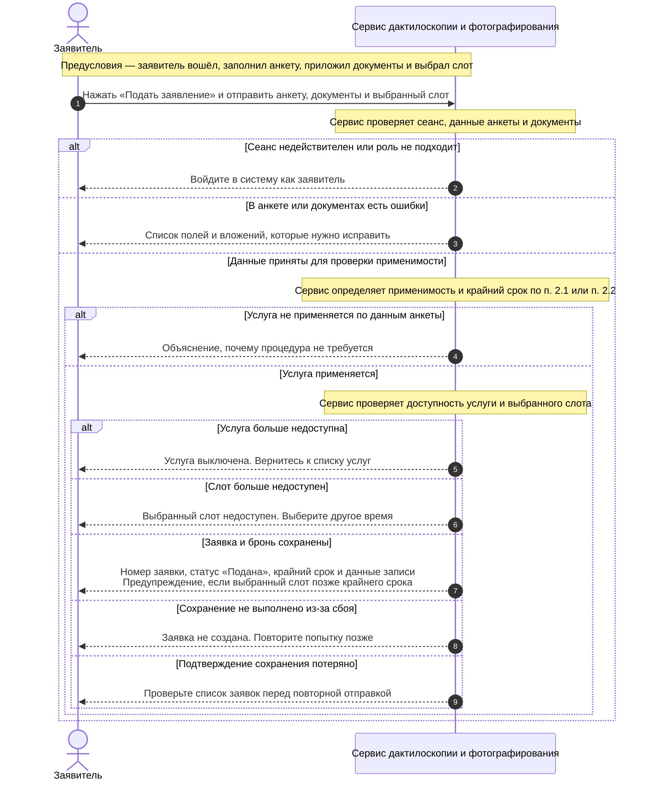

# Лабораторная работа № 3. Системная диаграмма последовательностей — «Подать заявление» (UC22)

## Границы прецедента

Показан UC22 «Подать заявление» из [диаграммы прецедентов](use_case.md). Сценарий начинается нажатием «Подать заявление» и отправкой подготовленной формы и завершается ответом заявителю. Система представлена одним участником. Подготовка формы, проверка сотрудником и очный визит относятся к другим прецедентам.

Перед подачей заявитель входит в систему, выбирает услугу, заполняет анкету (UC6), прикладывает документы (UC7) и выбирает подразделение и время (UC8). При подготовке формы сервис показывает список подразделений и свободных слотов. Заявитель передаёт выбор слота, затем сервис показывает предупреждение, если выбранная дата позже крайнего срока. Заявитель может выбрать другое время или продолжить подачу.

## Исходы подачи

| Условие | Ответ системы | Что делает заявитель |
| --- | --- | --- |
| Сеанс недействителен или роль не подходит | Просьба войти как заявитель | Входит под учётной записью заявителя |
| Ошибки в анкете или вложениях | Список полей и документов, которые нужно исправить | Исправляет данные и отправляет форму снова |
| По данным анкеты услуга не применяется | Объяснение, почему процедура не требуется | Читает причину и сверяет данные анкеты |
| Услуга выключена к моменту подачи | Сообщение, что услуга недоступна | Возвращается к списку услуг |
| Слот к моменту подачи недоступен | Предложение выбрать другое время | Выбирает свободный слот и повторяет подачу |
| Заявка и бронь сохранены | Номер заявки, статус «Подана», крайний срок и данные записи. Если слот позже срока, выводится предупреждение | Сохраняет данные записи и отслеживает статус |
| Сохранение не выполнено из-за сбоя | Сообщение, что заявка не создана | Повторяет попытку позже |
| Подтверждение сохранения потеряно | Предложение проверить список заявок | Проверяет, появилась ли заявка, прежде чем отправлять форму снова |

## Проверки и результат

- По п. 2.1 при трудовой цели и отсутствии ранее пройденной процедуры в РФ срок составляет 30 календарных дней со дня въезда. Если обращение за патентом происходит раньше, применяется дата обращения за патентом. Заявитель выбирает подразделение по вопросам миграции МВД по месту нахождения либо ФГУП «ПВС» МВД России.
- По п. 2.2 при нетрудовой цели и планируемом пребывании свыше 90 суток срок составляет 90 календарных дней со дня въезда.
- При подаче система повторно проверяет сеанс, анкету, документы, применимость услуги, её доступность и доступность слота. Для обязательных вложений действует [правило UC7](use_case.md#заявитель). Если слот стал занят, заявитель получает предложение выбрать другой. Поздний слот сопровождается предупреждением и сам по себе не блокирует подачу.
- При успехе система одновременно сохраняет заявку, документы, бронь и начальное событие истории «Подана». Если сохранение не выполнено, заявитель получает сообщение о сбое. Если исход сохранения неизвестен, он сначала проверяет список своих заявок, чтобы избежать повторной подачи.

После UC22 сотрудник начинает проверку, переводя заявку из «Подана» в «На проверке». Если требуется доработка, заявка переходит в «Требует дополнения», а после повторной отправки возвращается в «На проверке». Сотрудник сначала фиксирует прохождение очной процедуры, затем отдельно завершает заявку. Эти действия происходят за границей показанного сценария.

[ER-модель](er.md) · [Внутреннее взаимодействие объектов при подаче](class_sequence.md)
