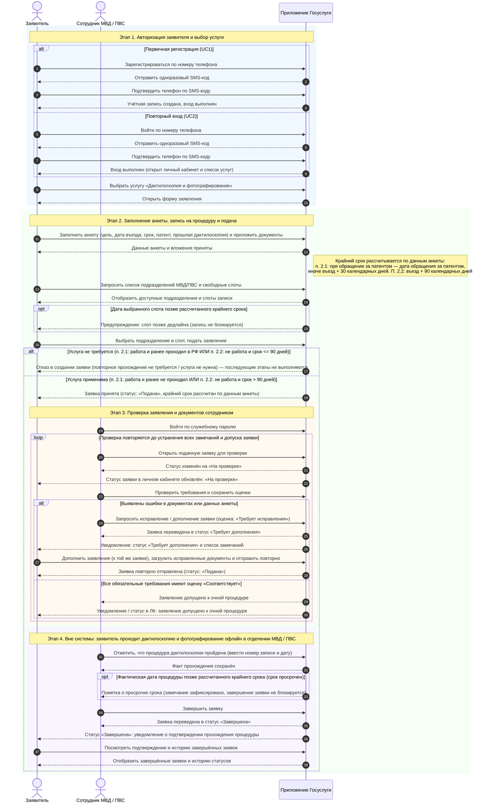

# Лабораторная работа № 3. Системная диаграмма последовательностей

## Диаграмма

## Границы моделирования и принцип «чёрного ящика»

Диаграмма последовательностей (`sequenceDiagram`) моделирует сквозной процесс оказания государственной услуги **«Дактилоскопия и фотографирование»** (раздел 2, пункты 2.1–2.2 дорожной карты) от авторизации заявителя до завершения обращения и просмотра результата. Прецеденты заявителя и сотрудника (UC1–UC16, UC22) покрываются этапами 1–4; служебные действия администратора по настройке справочников (UC17–UC19) выполняются заранее и указаны в предусловиях. Использование диаграммы внутри ветви применимости (см. `alt / else` на Этапе 2) гарантирует, что проверка, доработка и завершение возможны только для принятой заявки.

Приложение представлено как единый **«чёрный ящик»** (`Приложение Госуслуги`) без раскрытия внутренних классов, контроллеров, сервисов и прямых обращений к таблицам БД (внутренняя архитектура детализируется в следующей лабораторной работе):

* **Внешние участники (акторы):** `Администратор`, `Заявитель` и `Сотрудник МВД / ПВС`.
* **Обозначения сообщений:** сплошные стрелки (`->>`) отражают обращения и передачу данных от пользователей в систему; пунктирные стрелки (`-->>`) — ответы, подтверждения и уведомления, возвращаемые на экран.
* **Фрагменты управления потоком:**
  * `alt / else` — взаимоисключающие ветви сценария (выбор первичной регистрации или входа; проверка применимости услуги по п. 2.1–2.2, где этапы 3–4 проверки и завершения вложены только в ветвь принятой заявки);
  * `opt` — необязательное действие, выполняемое только при наступлении условия (предупреждение о слоте позже крайнего срока при записи на процедуру, фиксация пометки о просрочке при отметке факта прохождения);
  * `loop` — цикл повторной проверки заявки сотрудником после устранения замечаний и повторной отправки документов заявителем.
* **Вне границ системы:** физическое снятие отпечатков пальцев и фотографирование выполняются офлайн при личном визите заявителя в выбранное подразделение МВД или ПВС.

## Предусловия и входные данные по этапам

1. **Служебные учётные записи:** профили `Администратора` и `Сотрудника МВД / ПВС` заведены в системе заранее; авторизация выполняется по служебному логину и паролю.
2. **Наполнение справочников (предусловие):** администратор заранее добавляет в каталог услугу «Дактилоскопия и фотографирование», подразделения МВД/ПВС (наименование, адрес, график приёма) и открытые временные слоты для записи; без них заявителю нечего выбирать.
3. **Данные анкеты и вложения (Этап 2):**
   * сведения о визите: цель въезда (`работа` / `не работа`), дата въезда в РФ, планируемый срок пребывания (в днях), отметка о прохождении дактилоскопии и фотографирования на территории РФ ранее (`да` / `нет`), отметка об обращении за патентом и дата обращения (для цели `работа`);
   * электронные копии документов (паспорт, миграционная карта, виза при наличии);
   * выбранное подразделение МВД/ПВС и конкретный свободный слот записи.
4. **Данные проверки и завершения (Этапы 3–4):** оценки сотрудника по каждому проверяемому требованию (`Соответствует` / `Требует исправления`), перечень замечаний при возврате на доработку, а после очного визита заявителя — номер записи и дата фактического прохождения процедуры.

## Пошаговый сценарий взаимодействия

* **Этап 1 (Авторизация и выбор услуги):** заявитель проходит первичную регистрацию (`UC1`) либо повторный вход (`UC2`) по номеру телефона с подтверждением одноразовым SMS-кодом (`UC3`), открывает каталог услуг и выбирает «Дактилоскопия и фотографирование». Система открывает форму заявления.
* **Этап 2 (Заполнение анкеты, запись и подача):** заявитель заполняет данные анкеты и прикрепляет сканы документов (`UC6`, `UC7`), запрашивает доступные подразделения и свободные слоты (`UC8`), выбирает место и время приёма и отправляет заявление (`UC22`). Крайний срок рассчитывается по данным анкеты; если дата выбранного слота позже дедлайна, система предупреждает заявителя, не блокируя запись. Далее система проверяет применимость правил п. 2.1 и п. 2.2: при отсутствии оснований отклоняет создание заявки; при соблюдении условий сохраняет рассчитанный крайний срок, резервирует слот и присваивает заявке статус **«Подана»**.
* **Этап 3 (Цикл проверки и доработки):** сотрудник авторизуется по паролю и открывает заявку, переводя её в статус **«На проверке»** (заявитель видит смену статуса в личном кабинете). Соблюдение срока на этапе проверки не оценивается: он относится к дате прохождения процедуры. Сотрудник проверяет данные анкеты и документы по каждому требованию: при наличии ошибок запрашивает исправление/дополнение (статус **«Требует дополнения»**), заявитель досылает исправленные данные к той же заявке (**«Подана»**), и цикл проверки повторяется до полного допуска к очной процедуре.
* **Этап 4 (Офлайн-процедура и закрытие заявки):** после физического прохождения дактилоскопии и фотографирования в отделении сотрудник вводит номер записи и дату прохождения: система сравнивает фактическую дату с рассчитанным крайним сроком и при просрочке фиксирует пометку, не блокирующую завершение, после чего заявка завершается (статус **«Завершена»**). Заявитель получает уведомление о подтверждении прохождения процедуры и может просматривать завершённые заявки и историю статусов.

## Условия ветвлений и альтернативные исходы

| Условие / событие | Поведение системы и реакция для пользователя |
|---|---|
| П. 2.1: цель «работа», ранее в РФ не проходил (нет) | Заявка принимается. Крайний срок рассчитывается по формуле min(дата въезда + 30 календарных дней, дата обращения за патентом). |
| П. 2.1: цель «работа», ранее проходил в РФ (да) | Повторное прохождение не требуется. Система блокирует создание заявки и уведомляет заявителя. |
| П. 2.2: цель «не работа», срок пребывания > 90 дней | Заявка принимается без блокировки по факту прошлой процедуры (в дорожной карте ограничение для п. 2.2 отсутствует). Крайний срок = дата въезда + 90 календарных дней. |
| Цель «не работа», срок пребывания ≤ 90 дней | Обязательная дактилоскопия не требуется. Система информирует заявителя, заявка не формируется. |
| Дата выбранного слота позже рассчитанного крайнего срока (opt в Этапе 2) | Система предупреждает заявителя о слоте после дедлайна, но запись не блокирует. |
| Фактическая дата процедуры позже рассчитанного крайнего срока (opt в Этапе 4) | При отметке факта прохождения система фиксирует пометку о просрочке срока; завершение заявки не блокируется. |
| Ошибки в документах или данных анкеты (alt в цикле loop) | Заявка переводится в «Требует дополнения». После повторной отправки заявителем проверка запускается заново до устранения всех замечаний и получения оценки «Соответствует» по всем обязательным пунктам. |

## Согласованность данных и гарантии целостности

* **Синхронизация жизненного цикла и статусов:** все переходы состояний на диаграмме (∅ → Подана → На проверке → Требует дополнения → Подана → Завершена) полностью соответствуют журналу событий `STATUS_EVENT` и атрибуту `current_status` сущности `APPLICATION` в er.md.
* **Атомарность бронирования и создания заявки:** при подаче заявления (Этап 2) резервирование выбранного слота (`SLOT.is_available = false`), сохранение анкеты (`APPLICATION`), вложений (`DOCUMENT`) и стартового события истории выполняются как единая неделимая операция. При отказе по правилам п. 2.1–2.2 ни одна из записей не создаётся, а слот остаётся свободным.
* **Полнота и неизменность проверки:** в рамках каждой итерации цикла `loop` (Этап 3) сотрудник оценивает каждое проверяемое требование по его идентификатору `requirement_code` (`REVIEW` и `FINDING`), а после очного визита фиксирует единственный итоговый результат (`RESULT`), открывающий заявителю подтверждение прохождения услуги.

## Основания

Формат документа (system_sequence.md, ровно один блок sequenceDiagram с подробным описанием границ, сценариев, правил и гарантий целостности) соответствует требованиям курса ПИС. Предметные правила применимости и расчёта сроков согласованы с пунктами 2.1–2.2 дорожной карты, а состав ролей, прецедентов и сущностей — с use_case.md и er.md.
