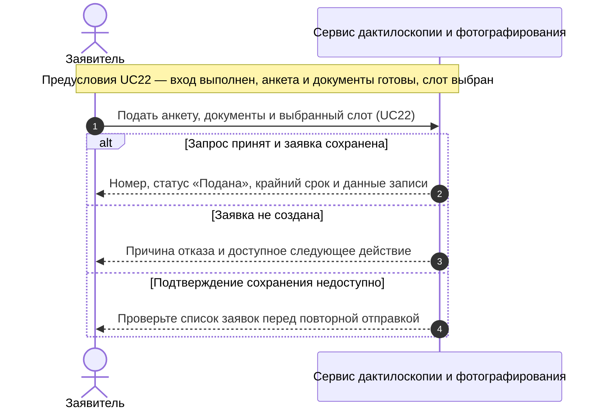

# Лабораторная работа № 3. Системная диаграмма последовательностей

## Границы прецедента

Показан UC22 «Подать заявление» из [диаграммы прецедентов](use_case.md). Сценарий начинается отправкой подготовленной формы и завершается ответом заявителю. Система представлена одним участником. Подготовка формы, проверка сотрудником и очный визит относятся к другим прецедентам.

Перед подачей заявитель входит в систему, выбирает услугу, заполняет анкету (UC6), прикладывает документы (UC7) и выбирает подразделение и время (UC8). При подготовке формы сервис показывает список подразделений и свободных слотов. Заявитель передаёт выбор слота, затем сервис показывает предупреждение, если выбранная дата позже крайнего срока. Заявитель может выбрать другое время или продолжить подачу.

## Проверки и результат

- По п. 2.1 при трудовой цели и отсутствии ранее пройденной процедуры в РФ срок составляет 30 календарных дней со дня въезда. Если обращение за патентом происходит раньше, применяется дата обращения за патентом. Заявитель выбирает подразделение по вопросам миграции МВД по месту нахождения либо ФГУП «ПВС» МВД России.
- По п. 2.2 при нетрудовой цели и планируемом пребывании свыше 90 суток срок составляет 90 календарных дней со дня въезда.
- При подаче система повторно проверяет сеанс, анкету, документы, применимость услуги и доступность слота. Если слот стал занят, заявитель получает предложение выбрать другой. Поздний слот сопровождается предупреждением и сам по себе не блокирует подачу.
- При успехе система одновременно сохраняет заявку, документы, бронь и начальное событие истории «Подана». Если подтверждение сохранения потеряно, заявитель сначала проверяет список своих заявок.

После UC22 сотрудник начинает проверку, переводя заявку из «Подана» в «На проверке». Если требуется доработка, заявка переходит в «Требует дополнения», а после повторной отправки возвращается в «На проверке». Сотрудник сначала фиксирует прохождение очной процедуры, затем отдельно завершает заявку. Эти действия происходят за границей показанного сценария.

[ER-модель](er.md) · [Внутреннее взаимодействие объектов при подаче](class_sequence.md)
