# Лабораторная работа № 3. Системная диаграмма последовательностей

## Назначение

Диаграмма показывает бизнес-процесс получения услуги: подачу заявления, проверку сотрудником, возможное исправление, очное прохождение дактилоскопии и фотографирования и получение подтверждения. Внутренние компоненты не раскрываются — приложение представлено одной системой.

## Диаграмма

```mermaid
sequenceDiagram
    autonumber
    actor Applicant as Заявитель
    actor Specialist as Сотрудник МВД/ПВС
    actor Admin as Администратор
    participant System as Сервис

    Note over Admin,System: До приёма администратор настраивает подразделения и слоты
    Admin->>System: Создать/обновить подразделения и слоты
    System-->>Admin: Справочники сохранены

    Applicant->>System: Зарегистрироваться / войти по телефону
    System-->>Applicant: Запрос SMS-кода
    Applicant->>System: Ввести код 123456
    System-->>Applicant: Учётная запись / сессия подтверждена

    Applicant->>System: Открыть услугу
    System-->>Applicant: Показать форму и условия
    Applicant->>System: Передать цель, дату въезда, срок пребывания,\nпредыдущую процедуру и сведения о патенте
    System->>System: Определить применимую ветку

    alt Работа, ранее НЕ проходил (п. 2.1)
        System->>System: Рассчитать min(въезд + 30 дней, дата патента если раньше)
    else Работа, ранее проходил (п. 2.1)
        System-->>Applicant: Повторная процедура по п. 2.1 не требуется
    else Иная цель и пребывание более 90 дней (п. 2.2)
        Note over System: Предыдущая процедура не блокирует ветку 2.2
        System->>System: Рассчитать въезд + 90 календарных дней
    else Иная цель и пребывание 90 дней или меньше
        System-->>Applicant: Услуга по п. 2.2 не требуется
    end

    opt Заявка применима
        System-->>Applicant: Показать крайний срок и требования
        Applicant->>System: Приложить удостоверение личности и документы
        Applicant->>System: Выбрать подразделение и слот
        System-->>Applicant: Показать доступность слота
        Applicant->>System: Нажать «Подать заявление»
        System->>System: Повторно проверить анкету, файлы и применимость
        alt Ошибки анкеты или документа
            System-->>Applicant: Показать ошибки, заявление не отправлено
        else Слот уже занят
            System-->>Applicant: Слот недоступен, выбрать другое время
        else Данные корректны и слот свободен
            System->>System: Атомарно сохранить заявку, версию, документы,\nтребования, запись и событие «Подана»
            System-->>Applicant: Заявление подано, показать номер и статус
        end
    end

    opt Заявление подано
        Specialist->>System: Открыть заявку и начать проверку
        System->>System: Создать проверку, установить «На проверке»\nи сохранить событие истории
        System-->>Specialist: Показать анкету, срок, документы и требования
        Specialist->>System: Сохранить оценки требований
        alt Выявлены исправимые недостатки
            Specialist->>System: Запросить исправления / документы
            System->>System: Сохранить замечания и запрос,\nустановить «Требует дополнения»
            System-->>Applicant: Передать список замечаний
            Applicant->>System: Исправить сведения и приложить документы
            Applicant->>System: Повторно подать заявление
            System->>System: Создать новую версию,\nустановить «Подана»
            System-->>Applicant: Новая версия принята
            Specialist->>System: Начать проверку новой версии
            System->>System: Установить «На проверке» до оценок
            Specialist->>System: Проверить новую версию и сохранить оценки
        else Недостатков нет
            Note over Specialist,System: Проверки пройдены, заявка ожидает фиксации очной процедуры
        end
    end

    opt Заявитель прошёл очную процедуру
        Note over Applicant,Specialist: Дактилоскопия и фотографирование выполняются офлайн
        Applicant->>Specialist: Явиться в подразделение и пройти обе процедуры
        Specialist->>System: Отметить дактилоскопию: дата и прибор
        System-->>Specialist: Отметка сохранена
        Specialist->>System: Отметить фотографирование: дата и прибор
        System-->>Specialist: Вторая отметка сохранена
    end

    opt Все обязательные требования пройдены и обе отметки сохранены
        Specialist->>System: Завершить заявку
        System->>System: Проверить актуальные оценки и обе отметки
        alt Срок просрочен
            System->>System: Сохранить предупреждение, не блокировать автоматически
        else Срок соблюдён
            System->>System: Зафиксировать соблюдение срока
        end
        System->>System: Создать результат, установить «Завершена»\nи сохранить событие истории
        System-->>Specialist: Заявка завершена
        Applicant->>System: Открыть результат и историю
        System-->>Applicant: Подтверждение, дата, подразделение,\nномер записи и история статусов
    end
```

## Пояснения и альтернативные исходы

1. Применимость проверяется до создания заявки. Для п. 2.1 предыдущее прохождение в РФ исключает повторную процедуру. Для п. 2.2 такого ограничения в дорожной карте нет.
2. Для п. 2.1 берётся более ранняя дата: въезд + 30 дней или дата обращения за патентом, если она раньше. Для п. 2.2 — въезд + 90 дней.
3. Заполнение формы и выбор слота не отправляют заявление автоматически. Заявитель явно нажимает «Подать заявление».
4. Проверка и резервирование слота выполняются атомарно; занятый слот нельзя назначить двум заявителям.
5. Статус «На проверке» устанавливается при начале проверки, до сохранения оценок.
6. Дополнение создаёт новую версию; прежние версии, оценки и история не перезаписываются.
7. Факт очной процедуры и завершение — разные действия. Сотрудник отдельно фиксирует дактилоскопию и фотографирование; завершение требует обе отметки.
8. Просрочка создаёт предупреждение, но не является автоматическим отказом.
